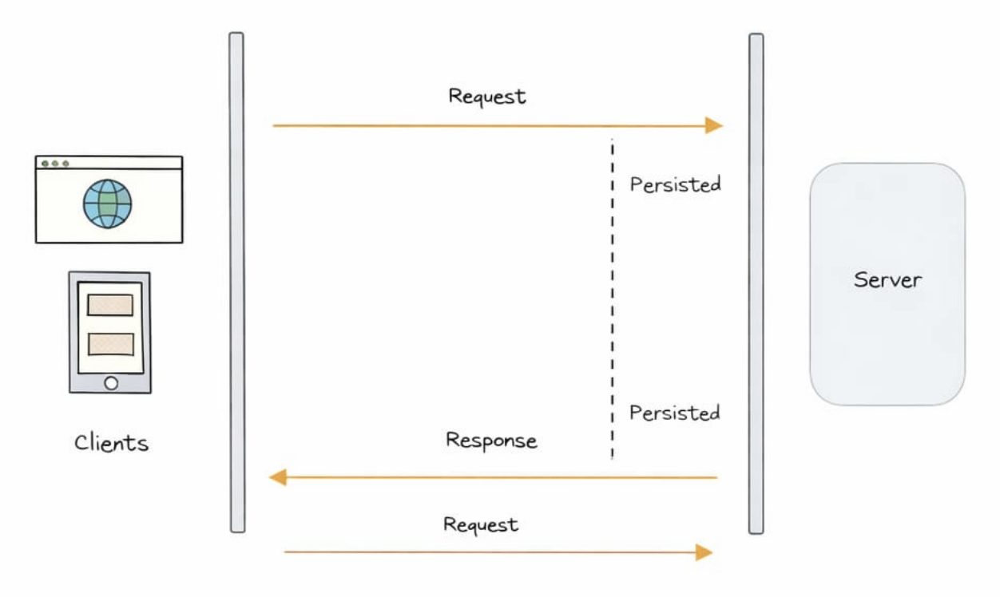

# Long Polling

Long polling is a technique where the client asks the server:

> “Do you have any new data for me?”
> But instead of the server replying immediately, it waits until new data is available (or a timeout happens).

So unlike short polling, the client does not keep asking repeatedly every few seconds — it keeps one request open.

#### Simple example

Think of it like this:

You message your friend and instead of asking again and again, you say:

> “Reply when you have something.”

Then you just wait.

As soon as your friend replies, you immediately get the answer.

That is how long polling works.

## How it works

1. Client sends a request to the server
2. Server does not respond immediately
3. Server waits until: new data is available, or a timeout occurs
4. Server sends the response
5. Client immediately sends a new request
6. This cycle continues

## Example use cases

Long polling is often used when:

- chat applications (before WebSockets)
- live notifications
- messaging systems
- collaborative tools (basic real-time sync)
- live dashboards with moderate real-time needs

## Advantages of long polling

1. More efficient than short polling: Requests are only completed when there is new data, reducing unnecessary calls.
2. Closer to real-time: Data is delivered as soon as it becomes available.
3. No need for advanced protocols: Works over standard HTTP (no WebSocket required).
4. Better for medium-scale apps: Handles real-time needs better without overwhelming the server like short polling.

## Disadvantages of long polling

1. Keeps connections open: Each client holds a connection for a long time, which can consume server resources.
2. Harder to scale: With many users, managing open connections becomes complex.
3. Timeout handling needed: Server must handle cases where no data arrives for a long time.
4. Slight delay between cycles: After receiving data, the client needs to send a new request again.

## Short Polling vs Long Polling (quick intuition)

Short polling:

> “Did you reply?” (asked repeatedly)

Long polling:

> “Tell me when you reply.” (waits for response)
