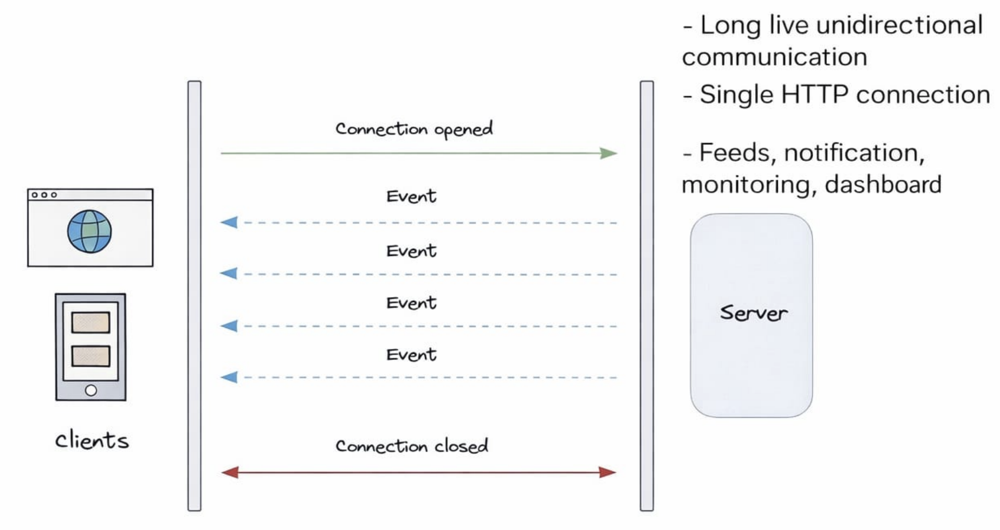

# Server Sent Event



## What is SSE

Server-Sent Events (SSE) is a unidirectional communication protocol where the
server pushes real-time updates to the client over a single long-lived HTTP
connection.

- Client → Server (only once to establish connection)
- Server → Client (continuous stream of updates)

## How SSE Works (Flow)

1. Client sends HTTP request using EventSource
2. Server responds with special headers ( text/event-stream )
3. Connection stays open (not closed like REST)
4. Server continuously sends messages in a specific format
5. Browser listens and triggers events automatically

## Basic Connection (Client)

```js
const eventSource = new EventSource("/sse");
eventSource.onmessage = (event) => {
  console.log(event.data);
};
```

## Required Headers (Server)

```js
Content-Type: text/event-stream
Cache-Control: no-cache
Connection: keep-alive
```

## Message Format (VERY IMPORTANT)

Each message must follow this structure:

> data: Your message here\n\n

Example:

> data: Hello\n\n
> data: Server Time: 10:30\n\n

Rules:

- Must start with data:
- Must end with \n\n
- Without \n\n → browser will NOT emit event

## Server Example

```js
app.get("/sse", (req, res) => {
  res.setHeader("Content-Type", "text/event-stream");
  res.setHeader("Cache-Control", "no-cache");
  res.setHeader("Connection", "keep-alive");
  res.write(`data: Connected\n\n`);
  const intervalId = setInterval(() => {
    res.write(`data: ${new Date().toLocaleTimeString()}\n\n
`);
  }, 5000);
  req.on("close", () => {
    clearInterval(intervalId);
    res.end();
  });
});
```

## Data Types

SSE only sends text

For JSON:

```js
res.write(`data: ${JSON.stringify({ msg: "hello" })}\n\n`);
```

Client:

```js
const data = JSON.parse(event.data);
```

## Custom Events

Server:

```js
res.write(`event: notification\n`);
res.write(`data: New message\n\n`);
```

Client:

```js
eventSource.addEventListener("notification", (event) => {
  console.log(event.data);
});
```

## Event Fields

| Field | Purpose                          |
| ----- | -------------------------------- |
| data  | actual payload                   |
| event | custom event name                |
| id    | event ID (used for reconnection) |
| retry | reconnection delay               |

Example:

> id: 1
> event: update
> data: Hello\n\n

## Connection Behavior

- Persistent HTTP connection
- Automatically reconnects on failure
- Uses Last-Event-ID for resuming

## Advantages

- Simple to implement (HTTP based)
- Built-in auto reconnect
- Lightweight compared to WebSockets
- Works over standard HTTP/1.1

## Limitations

- One-way communication only
- Text-only data
- Limited browser connection count (~6 per domain)
- Not ideal for high-frequency real-time apps

## Challenges

- Sticky sessions required for scaling
- Authentication handling
- Firewalls / proxies may block or buffer
- Backward compatibility issues
- Testing and debugging becomes tough
- Resource cleanup (open connections, memory leaks)
- Browser compatibility issues (no support in older browsers like IE, polyfills needed)
- Connection limits per browser/tab can cause issues in large apps
- Load balancers may terminate idle connections (timeouts)
- Load balancing complexity (connections must stay on same server → requires sticky sessions or shared pub/sub like Redis)
- No native support for binary data

## SSE vs WebSockets (Quick)

| Feature    | SSE                 | WebSocket    |
| ---------- | ------------------- | ------------ |
| Direction  | One-way             | Two-way      |
| Protocol   | HTTP                | WS           |
| Complexity | Simple              | Complex      |
| Use case   | Notifications, logs | Chat, gaming |

## When to Use SSE

- Live dashboards
- Notifications
- Logs streaming
- AI streaming responses
- Stock updates (low frequency)

## When NOT to Use

- Chat apps (bi-directional)
- Multiplayer apps
- High-frequency real-time systems
