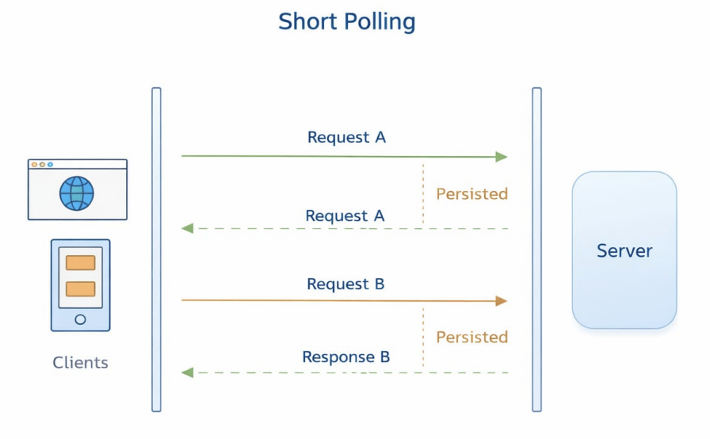

# Short Polling

Short polling is a way for a client, like a browser or app, to repeatedly ask the server:

> “Do you have any new data for me?”

It does this after a fixed time interval, like every 2 seconds, 5 seconds, or 10 seconds.

So instead of the server sending updates automatically, the client keeps checking again and again.

#### Simple example

Think of it like this:

You message your friend and then keep asking every minute:

> “Did you reply?”
> “Did you reply now?”
> “What about now?

That is basically how short polling works.

## How it works

1. Client sends a request to the server
2. Server sends back the current data
3. Client waits for a short time
4. Client sends another request
5. This keeps repeating

## Example use cases

Short polling is often used when:

- showing notifications
- checking order status
- refreshing dashboard data
- chat apps with basic real-time updates
- stock or weather updates at intervals

## Advantages of short polling

1. Easy to understand : It is one of the simplest ways to get updated data from a server.
2. Easy to implement : You can build it using normal HTTP requests with `fetch` or `axios` .
3. Works almost everywhere : Since it uses regular client-server requests, it works in most browsers and backend systems.
4. Good for small projects : For simple apps where real-time speed is not very critical, short polling is enough.

## Disadvantages of short polling

1. Wastes requests : The client keeps sending requests even when no new data is available.
2. Increases server load : Too many repeated requests can put extra pressure on the server.
3. Not truly real-time : Updates only arrive when the next request happens, so there can be delay.
4. Inefficient for large apps : If many users poll frequently, performance can become a problem.
