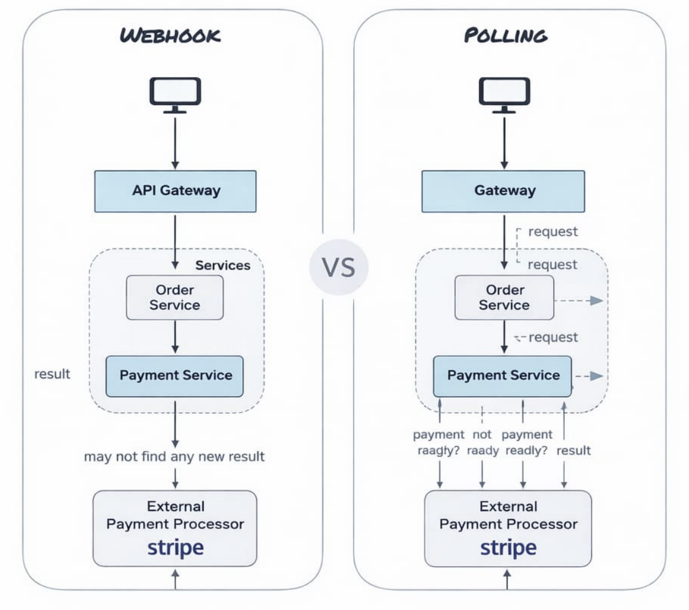

# WebHooks



## What are Webhooks

Webhooks are a way for one system to send real-time data to another system via HTTP callbacks when an event occurs.
Instead of polling:

- Client repeatedly asks → inefficient
- Server sends automatically when event happens → efficient

## How Webhooks Work (Flow)

1. Client registers a callback URL (endpoint)
2. Server stores that URL
3. Event happens on server (e.g., payment success)
4. Server sends an HTTP POST request to the callback URL
5. Client receives and processes the event

#### Basic Concept

> “Don’t call me, I’ll call you”

## Example (Real World)

- Payment gateway like Stripe
- You provide a webhook URL:

> https://yourapp.com/webhook

When payment succeeds:

```js
POST /webhook
Content-Type: application/json
{
 "event": "payment.success",
 "amount": 1000
}
```

## Server Example (Receiver)

```js
const express = require("express");
const app = express();
app.use(express.json());
app.post("/webhook", (req, res) => {
  const event = req.body;
  console.log("Webhook received:", event);
  if (event.event === "payment.success") {
    console.log("Payment successful");
  }
  res.status(200).send("OK");
});
app.listen(3000, () => {
  console.log("Webhook server running");
});
```

## Sender Example (Simulating Webhook)

```js
const axios = require("axios");
axios.post("http://localhost:3000/webhook", {
  event: "payment.success",
  amount: 1000,
});
```

## Key Characteristics

- Event-driven
- Uses standard HTTP (usually POST)
- Near real-time
- Decouples systems

## Webhooks vs Polling

| Feature     | Webhooks | Polling |
| ----------- | -------- | ------- |
| Approach    | Push     | Pull    |
| Efficiency  | High     | Low     |
| Latency     | Low      | High    |
| Server Load | Low      | High    |

## Webhooks vs SSE

| Feature    | Webhooks        | SSE              |
| ---------- | --------------- | ---------------- |
| Direction  | Server → Server | Server → Browser |
| Connection | Short-lived     | Long-lived       |
| Use case   | Backend events  | UI updates       |

## Payload Format

Usually JSON:

```js
{
 "event": "user.created",
 "data": {
 "id": 1,
 "name": "Aman"
 }
}
```

## Security (Important)

### 1. Signature Verification

- Sender signs payload using secret
- Receiver verifies it

```js
const crypto = require("crypto");
const expectedSignature = crypto
  .createHmac("sha256", SECRET)
  .update(JSON.stringify(req.body))
  .digest("hex");
```

### 2. HTTPS Only

- Always use HTTPS
- Prevent MITM attacks

### 3. IP Whitelisting (optional)

- Accept requests only from trusted IPs

## Retry Mechanism

- If webhook fails (non-200 response): → Sender retries

Common strategy:

- Exponential backoff

## Idempotency (Important)

Webhook may be delivered multiple times.

Design handlers to be idempotent

```js
// don't process same event twice
if (alreadyProcessed(event.id)) return;
```

## Challenges

- Handling duplicate events (idempotency)
- Retry handling and failures
- Security (signature validation)
- Debugging is difficult
- No guarantee of delivery order
- Network failures / downtime
- Endpoint must be publicly accessible
- Versioning issues in payloads
- Testing locally (need tunneling tools)

## Use Cases

- Payment notifications
- GitHub events (push, PR)
- CI/CD triggers
- Email delivery updates
- Slack bot events
