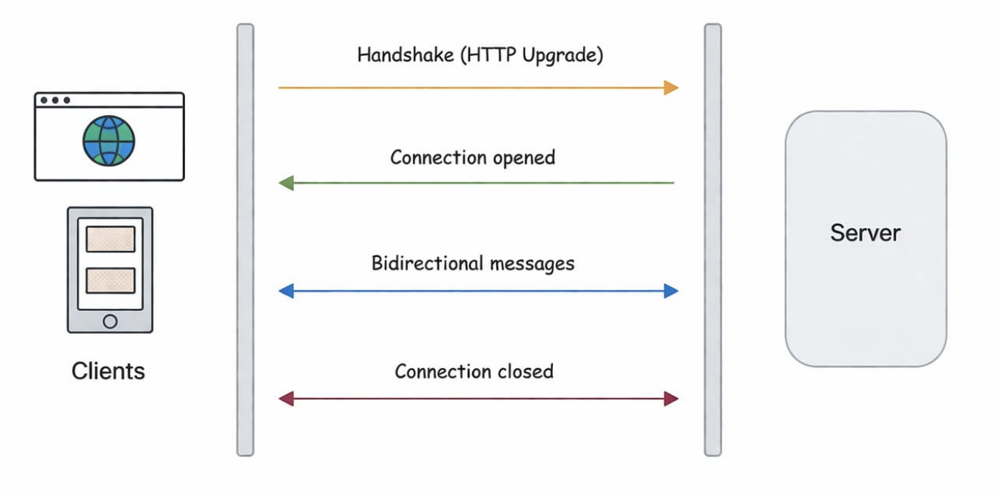

# WebSockets



WebSockets provide a persistent, full-duplex (two-way) communication channel between client and server.

Once the connection is established, both sides can send data at any time without creating new HTTP requests.

#### Simple example

Think of it like a phone call:

- You connect once
- Both sides can talk anytime
- No need to reconnect repeatedly

## How WebSocket connection is established

WebSockets begin as a normal HTTP request and then get upgraded to a WebSocket connection.

## Step-by-step flow

### 1. Client sends an HTTP request:

```js
GET /socket.io/?EIO=4&transport=websocket HTTP/1.1
Connection: Upgrade
Upgrade: websocket
```

### 2. Server responds:

```js
HTTP/1.1 101 Switching Protocols
Upgrade: websocket
Connection: Upgrade
```

### 3. Connection is upgraded:

- No longer standard HTTP
- Becomes a persistent connection

## What “Upgrade” means

- HTTP follows request → response → close
- WebSocket follows open → continuous communication

## How it works after connection

1. Client connects once
2. Connection remains open
3. Client can send data anytime
4. Server can send data anytime
5. No repeated requests are required

## How your code fits into this

```js
const io = new Server(server);
io.on("connection", (socket) => {});
socket.emit("chat-message", msg);
io.emit("chat-message", msg);
```

## Advantages

- Real-time communication
- No repeated requests
- Bidirectional communication
- Efficient

## Challenges in real-world systems

- Sticky sessions
- Horizontal scaling (multi-server sync)
- Connection limits
- Reconnection handling
- Message ordering and reliability
- Security concerns
- Authentication handling
- Firewalls and proxy issues
- Backward compatibility (fallback support)
- Testing and debugging becomes tough
- Resource cleanup (disconnect handling, memory leaks)

## Short Polling vs Long Polling vs WebSockets

- Short polling: repeated requests
- Long polling: wait then reconnect
- WebSockets: persistent connection

## Final intuition

- Short polling is simple but inefficient
- Long polling improves efficiency but still HTTP-based
- WebSockets enable real-time communication with continuous connection
