# Communication Protocols

Communication protocols are rules and standards that allow devices and applications to communicate over a network. They define how data is formatted, transmitted, received, and interpreted between systems.

Protocols operate at different layers of the network stack. Some protocols help applications communicate (Application Layer), while others manage the reliable delivery of data between devices (Transport Layer).

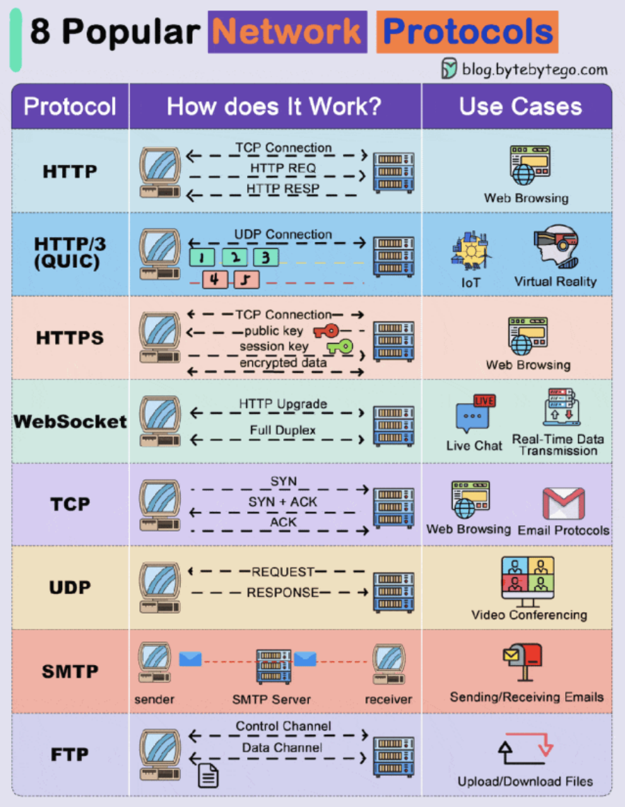

## 1. Application Protocols

Application protocols are used by software applications to communicate over the internet. These protocols define how messages are structured and exchanged between a client (such as a browser or mobile app) and a server.

Examples of common application protocols include:

- HTTP
- HTTPS
- WebSockets
- SMTP
- FTP

These protocols allow services such as web browsing, email communication, file transfers, and real-time messaging to function over the internet.

### HTTP (HyperText Transfer Protocol)

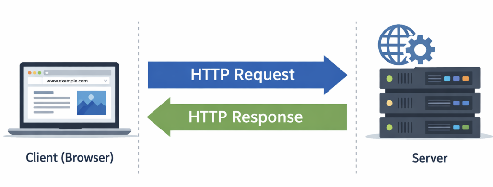

HTTP is the core protocol used for communication on the web. It defines how a client (usually a web browser) sends requests to a server, and how the server
responds with the requested resources.

When a user opens a website, the browser sends an HTTP request to the server asking for resources like:

- HTML files
- CSS stylesheets
- JavaScript files
- Images or media files
- API data (often JSON)

The server processes the request and returns an HTTP response containing the requested resource along with a status code and headers.

HTTP follows a request → response model, meaning the client always initiates communication and the server responds.

Another important characteristic of HTTP is that it is stateless. Each request is treated independently, meaning the server does not automatically remember
previous interactions. Technologies such as cookies, sessions, and tokens are used to maintain user state.

HTTP operates on top of TCP, which ensures reliable data delivery.

Default Port: 80

Example communication flow:

```js
Browser → HTTP Request → Server
Server → HTTP Response → Browser
```

### HTTP/3

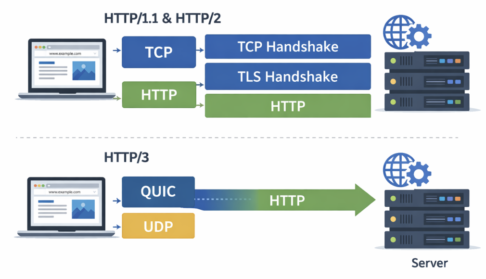

HTTP/3 is the latest version of the HTTP protocol, designed to improve performance and reduce latency.

Earlier versions of HTTP such as HTTP/1.1 and HTTP/2 use TCP for communication. HTTP/3 instead uses the QUIC protocol, which is built on top of UDP.

QUIC improves performance by reducing the number of steps required to establish a connection. In older HTTP versions, a connection requires both:

- A TCP handshake
- A TLS encryption handshake

QUIC combines these processes, allowing connections to be established faster.

Another key improvement is how packet loss is handled. In TCP-based HTTP versions, if one packet is lost, the entire data stream may be delayed. QUIC allows
independent data streams, preventing delays and improving performance on slow or unstable networks.

Key advantages of HTTP/3 include:

- Faster connection establishment
- Lower latency
- Better performance on unreliable networks
  Reduced delays caused by packet loss

### HTTPS (HyperText Transfer Protocol Secure)

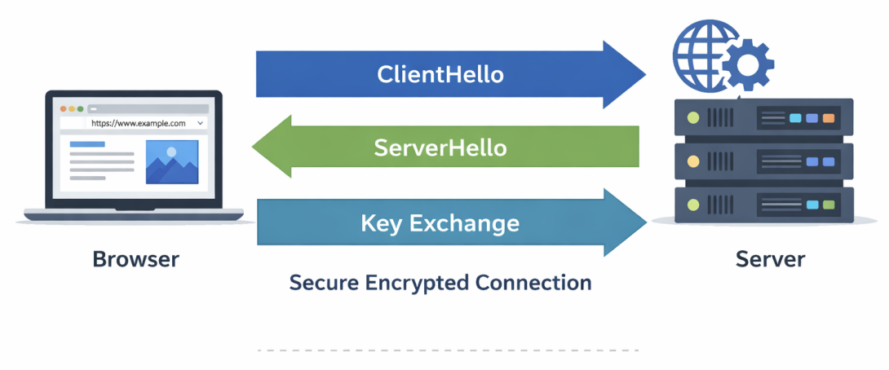

HTTPS is the secure version of HTTP, used for safe communication between a browser and a server.

HTTPS works the same way as HTTP but adds a security layer using SSL/TLS encryption. This encryption ensures that data exchanged between the client and server cannot be intercepted or modified by attackers.

When a user visits an HTTPS website, the browser and server first perform a TLS handshake to establish a secure encrypted connection.

After the secure connection is established, all transmitted data such as:

- Login credentials
- Payment details
- Personal information

is encrypted.

Modern browsers indicate secure connections by displaying a lock icon in the address bar.

Default Port: 443

### WebSockets

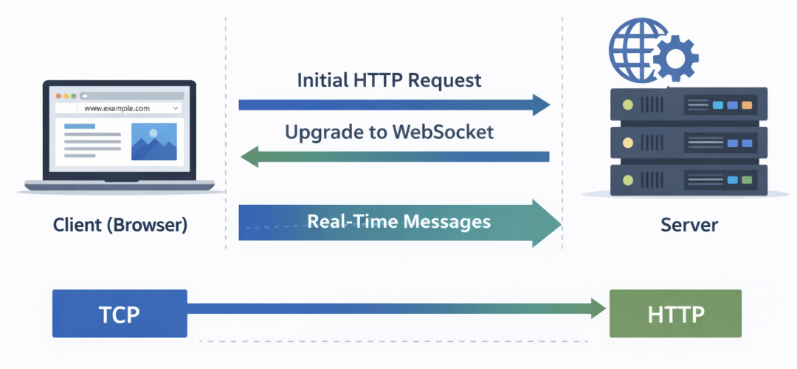

WebSockets is a protocol that enables real-time, bidirectional communication between a client and a server.

Unlike HTTP, where the client must repeatedly send requests to get new data, WebSockets establish a persistent connection that remains open.

This allows both the client and server to send data to each other at any time.

The WebSocket connection begins as a normal HTTP request. The client asks the
server to upgrade the connection using the HTTP Upgrade mechanism. Once the upgrade is accepted, the communication switches from HTTP to the WebSocket
protocol.

Because the connection stays open, WebSockets reduce overhead and provide low-latency communication.

Common use cases include:

- Chat applications
- Live notifications
- Multiplayer games
- Real-time dashboards
- Stock market updates

### SMTP (Simple Mail Transfer Protocol)

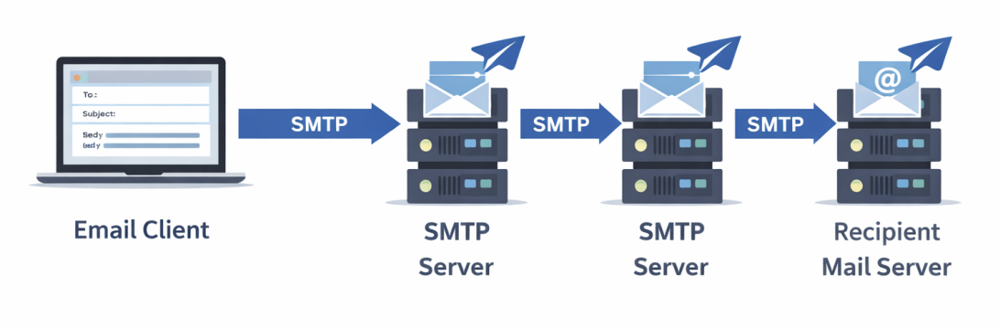

SMTP is the protocol used for sending email messages across the internet.

When a user sends an email from an application like Gmail or Outlook, the emailclient uses SMTP to send the message to a mail server. The message may pass
through multiple mail servers before reaching the recipient’s server.

SMTP handles sending and forwarding emails, but it does not retrieve them. Protocols such as IMAP or POP3 are used to receive emails.

Common SMTP ports include:
25

- 465
- 587
  Example flow:

```js
Email Client → SMTP Server → Recipient Mail Server
```

### FTP (File Transfer Protocol)

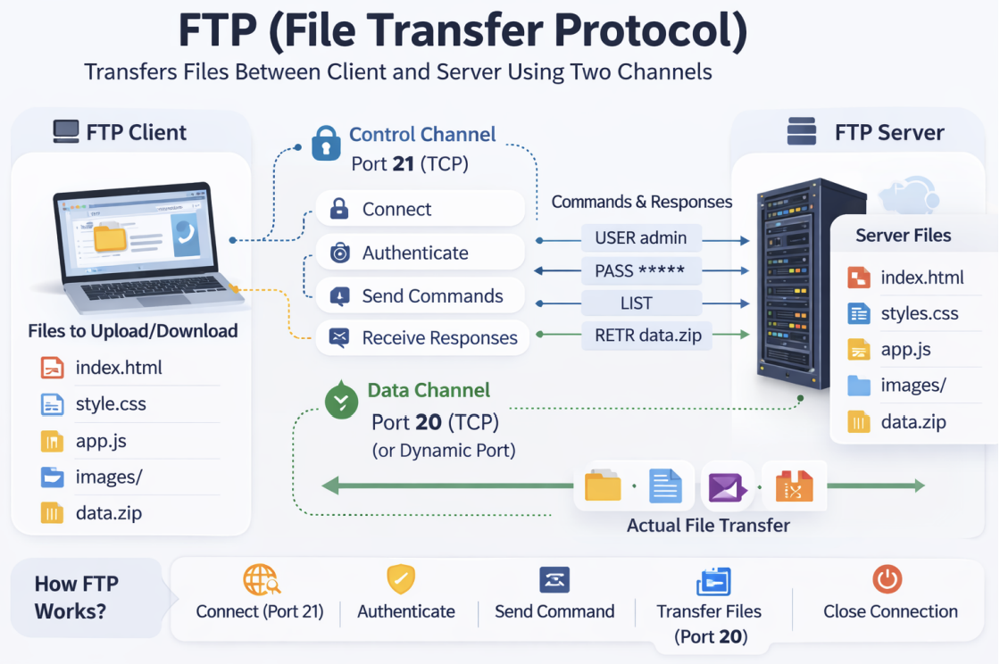

FTP is a protocol used for transferring files between a client and a server over a network.

Developers often use FTP to upload website files such as HTML, CSS, JavaScript, and images to a web server.
FTP works using a client–server model and establishes a connection to transfer files.

One unique feature of FTP is that it uses two communication channels:

1. Control Channel – used for commands and responses
2. Data Channel – used for transferring files

Traditional FTP does not encrypt data, which is why more secure alternatives such as FTPS and SFTP are commonly used today.

Default Port: 21

## 2. Transport Protocols

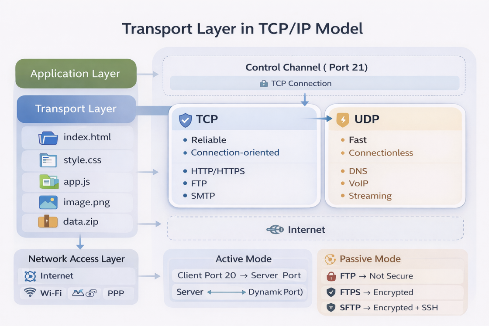

Transport layer protocols are responsible for delivering data between devices across a network.

They manage how data packets are transmitted, ensuring that the information sent from one device reaches the correct destination.

The two main transport protocols are:

- TCP (Transmission Control Protocol)
- UDP (User Datagram Protocol)

TCP focuses on reliability, while UDP focuses on speed and efficiency

### TCP (Transmission Control Protocol)

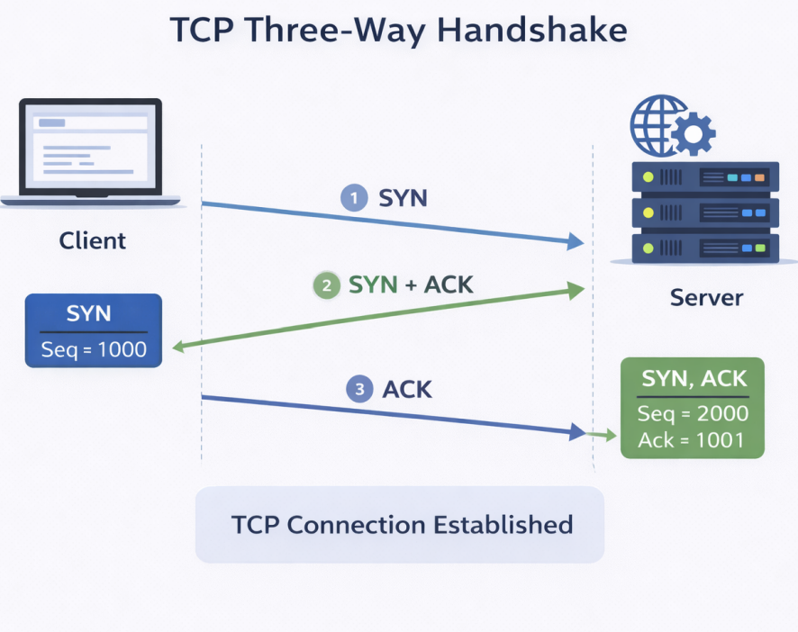

TCP is a connection-oriented protocol that ensures reliable data transmission between devices.

Before sending data, TCP establishes a connection between the client and server using a process called the Three-Way Handshake.

TCP guarantees:

- Reliable delivery of data
- Correct packet ordering
- Error detection
- Retransmission of lost packets

Because of these reliability mechanisms, TCP is slightly slower but highly dependable.
Protocols such as HTTP, HTTPS, SMTP, and FTP rely on TCP.

### TCP Three-Way Handshake

The TCP connection is established through three steps:

#### Step 1 — SYN

The client sends a SYN packet to the server requesting a connection.

```js
Client → SYN → Server
```

#### Step 2 — SYN-ACK

The server acknowledges the request and responds with a SYN-ACK packet.

```js
Client ← SYN + ACK ← Server
```

#### Step 3 — ACK

The client sends an ACK packet, confirming the connection.

```js
Client → ACK → Server
```

Once these three steps are completed, the connection is established and data transfer begins.

### UDP (User Datagram Protocol)

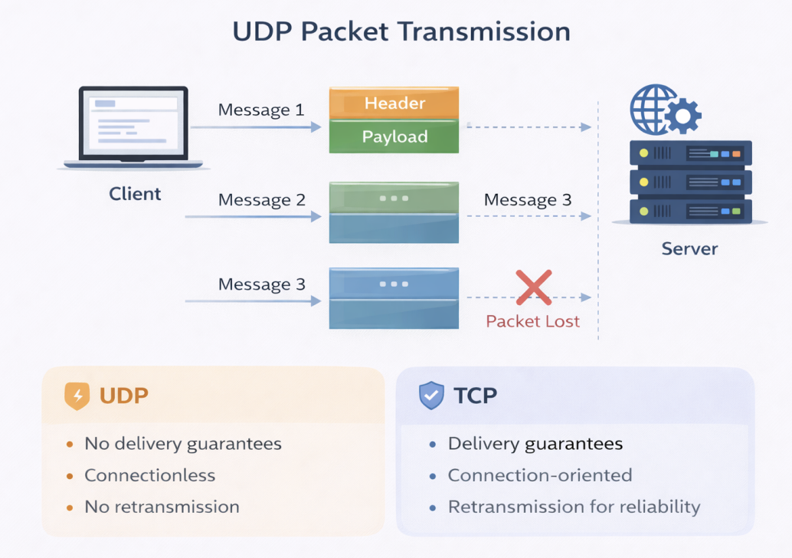

UDP is a connectionless transport protocol designed for fast communication.

Unlike TCP, UDP does not establish a connection before sending data. Instead, it simply sends packets (called datagrams) directly to the destination.

UDP does not guarantee:

- Packet delivery
- Packet order
- Error correction

Because UDP avoids these reliability checks, it has very low latency and minimal overhead, making it extremely fast.

#### UDP Packet Structure

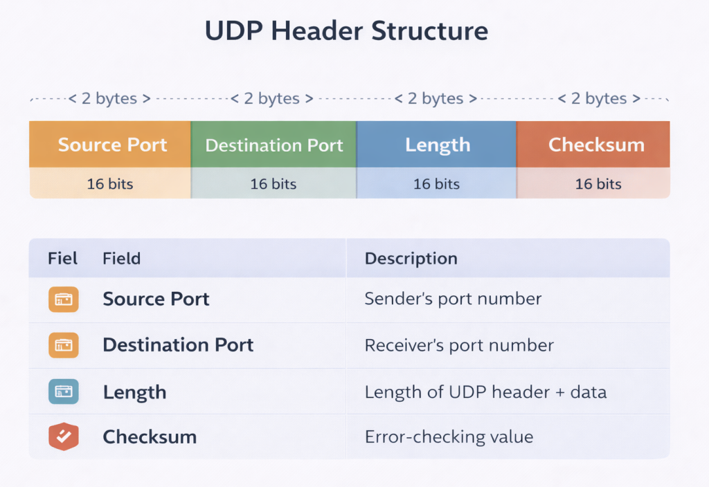

A UDP packet contains only a few fields:

- Source Port
- Destination Port
- Length
- Checksum

Because the header is small, UDP packets are lightweight and efficient.

Common Uses of UDP
UDP is commonly used in applications where speed is more important than reliability, such as:

- Video streaming
- Online gaming
- DNS queries
- Voice calls (VoIP)
- Live broadcasts
  In these applications, small packet loss is acceptable, but low latency is critical.

### TCP vs UDP

| Feature        | TCP                       | UDP                    |
| -------------- | ------------------------- | ---------------------- |
| Connection     | Connection-oriented       | Connectionless         |
| Reliability    | Reliable                  | Unreliable             |
| Packet Order   | Guaranteed                | Not guaranteed         |
| Speed          | Slower                    | Faster                 |
| Error Handling | Retransmits lost packets  | No retransmission      |
| Use Cases      | Web, Email, File Transfer | Streaming, Gaming, DNS |
