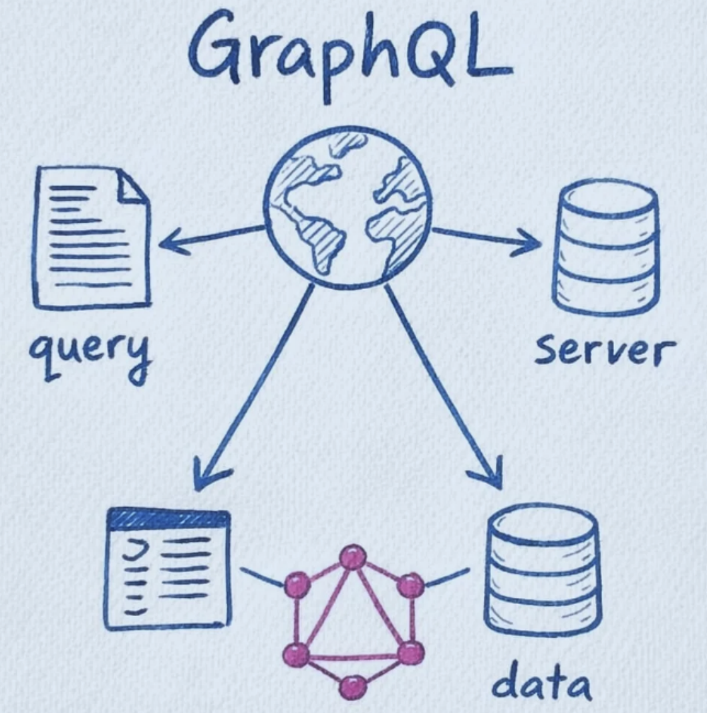
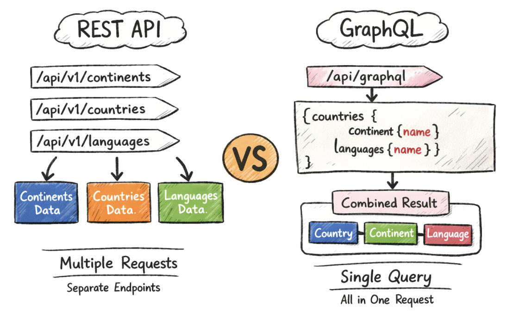
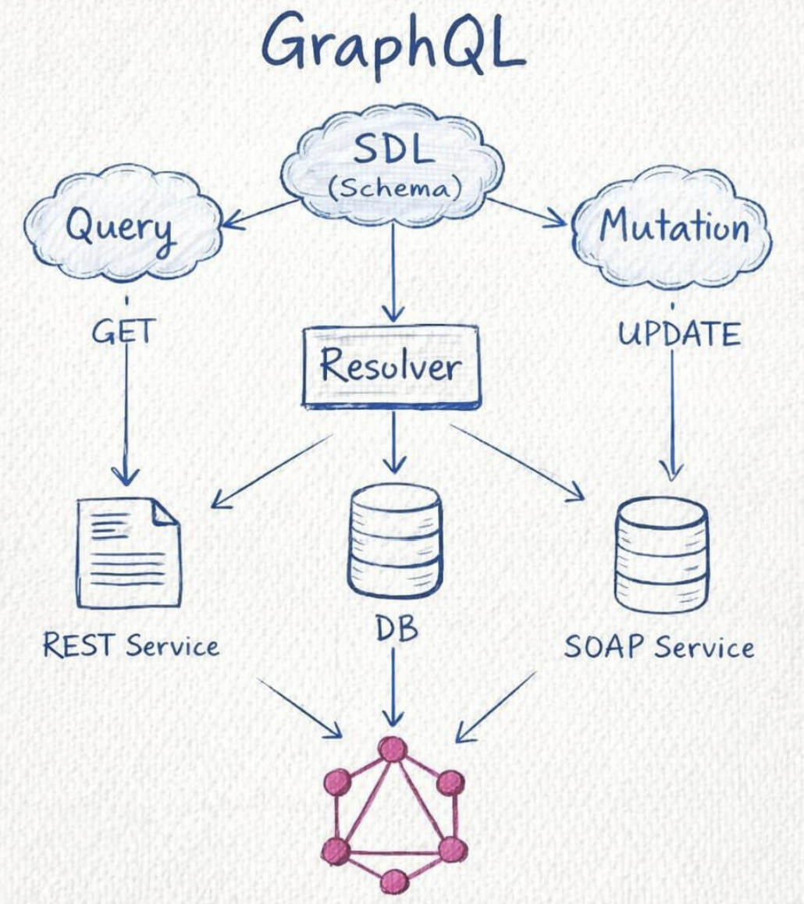

# GraphQL



GraphQL is a query language for APIs and a runtime for executing those queries, where the client can request exactly the data it needs from a single endpoint instead of relying on multiple fixed REST endpoints; it uses a strongly typed schema to define available data and relationships, supports queries for fetching data and mutations for changing data, and helps reduce over-fetching and underfetching by giving frontend developers more control over the response structure.

| Feature             | REST API                                                                                                | GraphQL                                                      |
| ------------------- | ------------------------------------------------------------------------------------------------------- | ------------------------------------------------------------ |
| Endpoints           | `api/v1/continents` `api/v1/countries` `api/v1/languages`                                               | `api/graphql`                                                |
| How data is fetched | Separate endpoints for continents, countries, and languages                                             | One endpoint for all data                                    |
| Example use case    | To get country with its continent and language, you may call countries, then continents, then languages | To get country, continent, and language, one query is enough |
| Data returned       | Server gives fixed response                                                                             | Client asks only for needed fields                           |
| Requests            | Often multiple requests                                                                                 | Usually single request                                       |
| Best for            | Simple resource-based APIs                                                                              | Flexible nested data fetching                                |



## Benefits of GraphQL

| Benefit                     | What it means                                                              |
| --------------------------- | -------------------------------------------------------------------------- |
| Avoids over-fetching        | Client gets only the required fields, not extra unwanted data              |
| Avoids under-fetching       | Related data can be fetched in a single query instead of multiple requests |
| Better mobile performance   | Smaller responses and fewer network calls help on slow internet            |
| Single endpoint             | Everything is usually handled through one /graphql endpoint                |
| Flexible data fetching      | Frontend can shape the response based on UI needs                          |
| Strongly typed schema       | Clear structure makes APIs easier to understand and validate               |
| Faster frontend development | Frontend teams can request exactly what each screen needs                  |
| Easier evolution of APIs    | New fields can be added without breaking existing queries                  |
| Better developer experience | Tools like autocomplete, validation, and docs work very well               |
| Efficient for complex data  | Great for nested and connected data like users, posts, comments, products  |

## Comparison of REST vs GraphQL

| Feature                    | REST                                                             | GraphQL                                                        |
| -------------------------- | ---------------------------------------------------------------- | -------------------------------------------------------------- |
| Full form / idea           | Representational State Transfer, an API style based on resources | Query language for APIs where client asks for exact data       |
| Endpoint structure         | Multiple endpoints for different resources                       | Usually a single endpoint like `/graphql`                      |
| Data fetching style        | Server decides response shape                                    | Client decides response shape                                  |
| Response data              | Fixed structure                                                  | Flexible structure                                             |
| Over-fetching              | Common, extra data may come even when not needed                 | Avoided, only requested fields are returned                    |
| Under-fetching             | Common, may require multiple endpoints to complete one screen    | Reduced, related data can be fetched together                  |
| Number of network requests | Often multiple requests for related resources                    | Often one query is enough                                      |
| Nested/related data        | Harder, usually fetched through separate endpoints               | Natural and easy through nested queries                        |
| Mobile performance         | Can be less efficient due to larger payloads and extra requests  | Often better because of smaller payloads and fewer calls       |
| Backend control            | Strong backend control over response format                      | More client freedom in choosing fields                         |
| Frontend flexibility       | Limited by endpoint design                                       | Very high, UI can ask for exactly what it needs                |
| API evolution              | Often needs versioning like `/api/v1` , `/api/v2`                | Usually evolves by adding fields, often no versioning          |
| Versioning                 | Common                                                           | Rarely needed                                                  |
| Documentation              | External docs often needed                                       | Schema acts like self-documentation                            |
| Tooling                    | Good, but depends on framework/docs                              | Excellent, with schema introspection, autocomplete, playground |
| Learning curve             | Easier for beginners                                             | Slightly harder at first                                       |
| Caching                    | Easier with HTTP caching                                         | More complex, usually handled at client/tool level             |
| Error handling             | Uses HTTP status codes clearly                                   | Often returns 200 OK with errors inside response body too      |
| File upload                | Straightforward with HTTP forms                                  | Possible, but not as direct as REST                            |
| Rate limiting / monitoring | Simpler per endpoint                                             | Can be trickier because all requests hit one endpoint          |
| Security handling          | Easier to manage endpoint-wise                                   | Needs extra care for deep queries and query cost control       |
| Best use case              | Simple CRUD APIs, public APIs, predictable resources             | Complex apps with connected data and dynamic UI needs          |

## Components of GraphQL



### 1. Schema / Types

The schema is the blueprint of a GraphQL API. It defines what data exists, what
fields are available, and what operations clients can perform. Types describe the shape of data, like `User` , `Post` , or `Product` .

```js
type User {
    id: ID!
    name: String!
    age: Int
}
type Query {
    users: [User]
}
```

Here, `User` is a type, and the schema says that `users` can be fetched.

### 2. Query

A query is used to fetch data from the GraphQL server. It is similar to a `GET`
request in REST, but the client can choose exactly which fields it wants.

```js
query {
    users {
    id
    name
    }
}
```

This fetches only `id` and `name` for all users.

### 3. Mutation

A mutation is used to create, update, or delete data. It is similar to `POST` , `PUT` , `PATCH` , or `DELETE` in REST

```js
type Mutation {
    addUser(name: String!, age: Int): User
}
mutation {
    addUser(name: "Aman", age: 21) {
    id
    name
    age
    }
}
```

This adds a new user and returns the created user data.

### 4. Resolver

A resolver is a function that contains the actual logic for returning data for a query or mutation. It tells GraphQL how to fetch or update the data.

```js
const resolvers = {
  Query: {
    users: () => {
      return [
        { id: "1", name: "Aman", age: 21 },
        { id: "2", name: "Rahul", age: 22 },
      ];
    },
  },
  Mutation: {
    addUser: (_, args) => {
      const newUser = {
        id: "3",
        name: args.name,
        age: args.age,
      };
      return newUser;
    },
  },
};
```

Here:

- `users` resolver returns all users
- `addUser` resolver creates a new user
