# How the Web Works

- Hitting an endpoint like www.flipcart.com
- Check the frist call in the network tab
- Request sent
- Response received
- HTML code - rendered in browser
- CSS files for look and feel
- JS files for interactivity

Machine on a server is sending the files, any machine can be a server, eg: your laptop, but its not on all the time or has memory required.
So we use `high end server` deicated, available 24/7

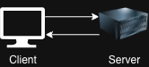

You have to know the IP address to connect to a server, but a domain name is used for ease.

Your cell tower/wifi internet access asks DNS and gets the IP address and then calls the correct IP address.

## Old method of Internet Access

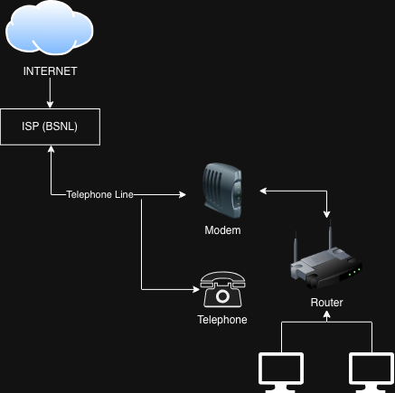

Wesite being served

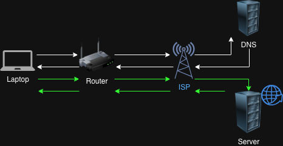

Imagine trying to connect 10 laptops together with LAN - Network Hell!

Wireless can be impacted by weather, connectivity over distance etc

Internet is connected with both wired and wireless

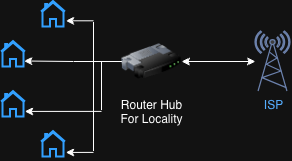

## DNS

For example, `www.google.com` uses all the parts of the domain name to reach the appropriate server to serve that website (eg: a data center.)

- Root domain `.`
- Top-level domain `com`
- Second-level domain `google`
- Third-level domain `www`

### How Do You Travel Across Servers?

You can send a request to a server located in another country. The data travels through a global network of routers, cables, and wireless systems to reach that
server.

Most long-distance internet communication happens through undersea and land optical fiber cables, although some parts may use wireless links.

However, the farther the server is from the user, the higher the latency (delay).

This is why many companies place servers in multiple regions or data centers around the world to reduce latency and serve users faster.

To connect networks across countries and continents, we use optical fiber cables, many of which run under the sea (submarine cables).

Optical fibers transmit data as pulses of light through very thin strands of glass or plastic. Because light travels extremely fast and with very little signal loss, optical fibers can carry huge amounts of data over long distances.

These undersea fiber cables form the backbone of the global internet, connecting continents and allowing data to travel quickly between servers and users around the world.

### ICANN

ICANN (Internet Corporation for Assigned Names and Numbers) is the organization responsible for managing and coordinating the internet’s domain name system (DNS).

Its main job is to ensure that every domain name is unique and correctly mapped to its corresponding IP address so that users can reliably reach websites.

ICANN oversees top-level domains (TLDs) such as .com , .org , and country domains like .in . It works with domain registries and registrars to keep the global
domain naming system organized, stable, and secure.

### WHOIS

You can lookp up who the domain belongs to, but with privacy protection.

TCP Handshake:
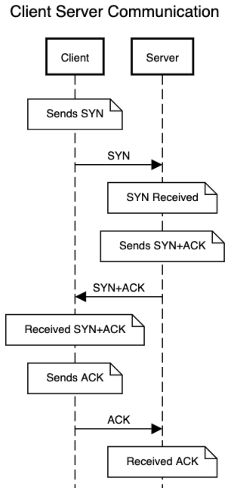

Website fetch:
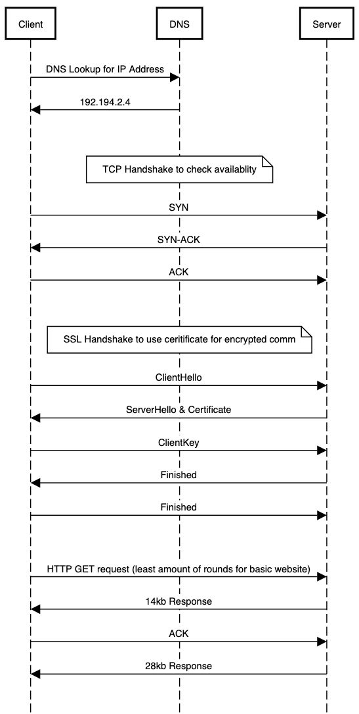

## ISPs and How Data Travels Between Countries

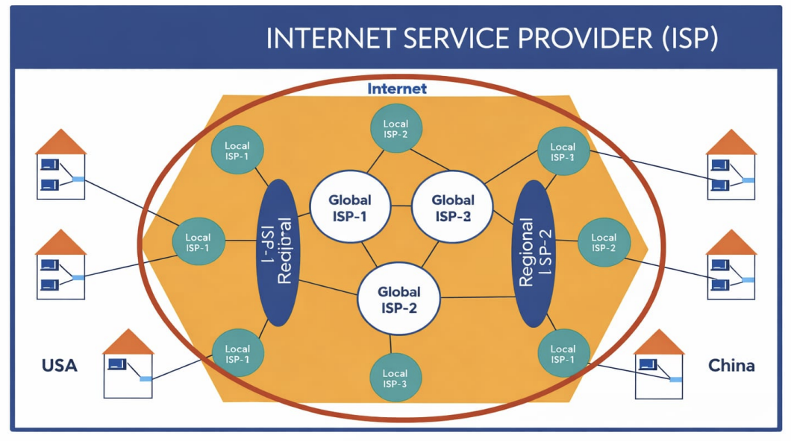
Internet communication happens through different levels of Internet Service Providers (ISPs).

- Local ISP: A local ISP provides internet access to homes and businesses in a city or small region. Your device connects to this ISP through Wi-Fi, Ethernet, or mobile
  networks.
- Regional ISP: Local ISPs connect to regional ISPs, which manage larger network infrastructure across multiple cities or states and handle a much larger volume of traffic.
- Global ISP (Backbone Providers): Regional ISPs connect to global backbone providers. These companies operate
  massive high-speed fiber networks, including undersea optical fiber cables, that connect different countries and continents.

### How Data Travels Between Countries

When you request data from a server in another country:

1. Your device sends the request to your local ISP.
2. The request moves to a regional ISP.
3. It then travels through global backbone networks via optical fiber cables,
   often across oceans.
4. The request eventually reaches the data center hosting the server.

Data is not sent as one large piece. Instead, it is broken into small units called packets.

Each packet travels through multiple routers, and every step it takes is called a hop. Routers decide the best path for each packet until it finally reaches the
destination server.

The server then sends packets of the response back through the network to your
device, where they are reassembled to form the final data.

## Your devices

There is caching at various levels

- Browser (Cache, Service Worker)
- Operating System (Needs host file modified or configured)
- Router
- ISP

### Stale while revalidate

If the user needs to reclaim disk space you don't want to be the prime candidate. Make sure you get rid of items in the cache you don't need any more.

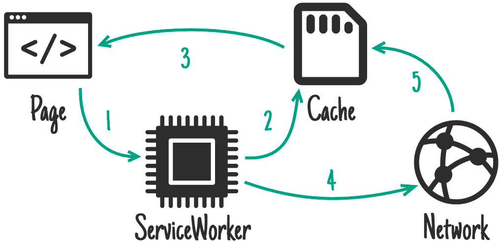

Example of this concept by observing a website:

- Fetch wesite, it returns 304 status (not modified)
- Fetch calls with 200 but from Service Worker
- Fetch call from disk cache

> Brower can make 6-8 request parallely (depends on the browser), rest is queued

### ISP Peering

ISP peering is when two networks or ISPs connect directly to exchange internet traffic instead of sending it through other intermediary networks. This reduces latency, cost, and the number of hops data must travel.

Large companies like Google use extensive peering with ISPs and place edge servers (Google Global Cache) close to or inside ISP networks. This allows users to receive content from nearby servers, making services like YouTube and
Google Search faster and more efficient.

## Rendering A Page

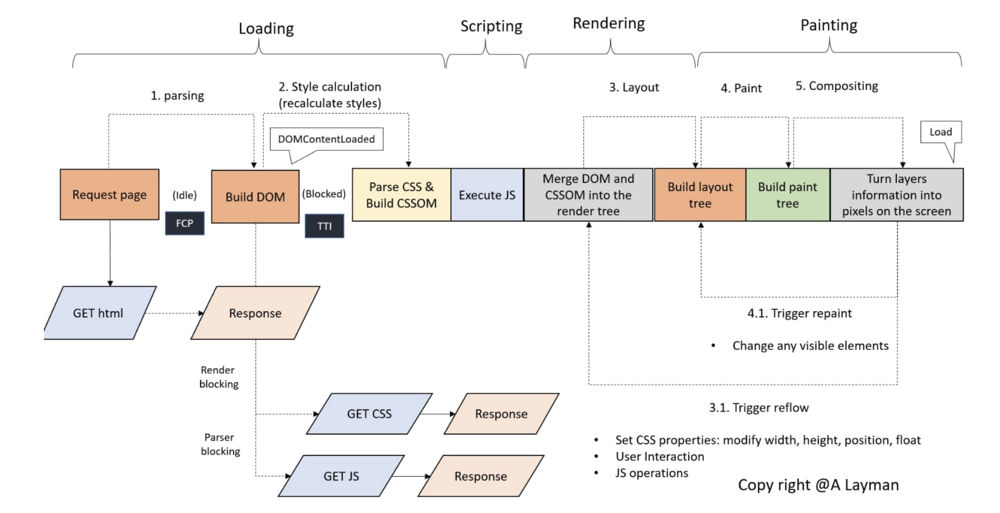

### Browser Rendering Pipeline

> (Loading → Scripting → Rendering → Painting)

When a browser receives a webpage response, it processes the content through several internal stages before pixels appear on the screen.

#### 1. Loading (Parsing Resources)

The process begins when the browser requests the HTML document from the server.

- The browser parses the HTML and starts building the DOM (Document Object Model).
- While parsing HTML, the browser discovers external resources like CSS and JavaScript.
- CSS files are downloaded and parsed to build the CSSOM (CSS Object Model).

Important behavior:

- CSS is render-blocking because styles are needed before rendering.
- JavaScript can be parser-blocking, meaning HTML parsing pauses until the script executes.

Once HTML is parsed, the DOMContentLoaded event fires.

#### 2. Scripting (Executing JavaScript)

After resources are loaded, the browser executes JavaScript.

JavaScript can:

- Modify the DOM
- Change CSS styles
- Trigger additional network requests
- Attach event listeners

Because JavaScript can modify the structure and styles of the page, it can cause the browser to recalculate styles.

#### 3. Rendering (Layout / Reflow)

Next, the browser combines the DOM and CSSOM to build the Render Tree.

The Render Tree only contains visible elements and their computed styles.

Then the browser performs Layout (Reflow):

- Calculates size
- Determines position
- Determines geometry of each element

Layout can be triggered by:

- Changing width / height
- Changing position or float
- User interactions
- Certain JavaScript operations

#### 4. Painting

After layout is computed, the browser moves to painting.

Here the browser:

- Builds a paint tree
- Draws visual elements like
  - text
  - colors
  - images
  - borders
  - shadows

These drawing instructions are converted into pixels.

#### 5. Compositing

Finally, the browser combines different layers and sends them to the GPU.

The GPU converts layer information into actual pixels displayed on the screen.

Modern browsers use layer compositing to improve performance, especially for animations and scrolling.

### DOM and CSSOM

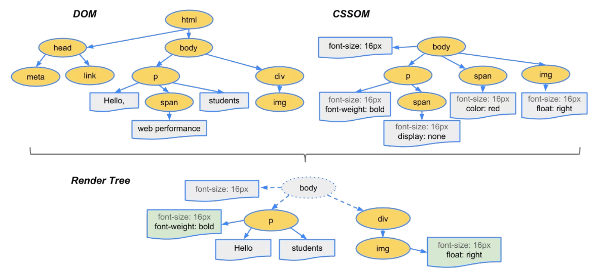

During the loading phase, the browser starts parsing the resources it receives.

#### DOM (Document Object Model)

The DOM is created when the browser parses the HTML document.

As the browser reads the HTML line by line, it converts the elements into a tree structure of nodes called the DOM tree.

Example flow:

> HTML → Parsing → DOM Tree

#### CSSOM (CSS Object Model)

The CSSOM is created when the browser downloads and parses CSS files.

The CSS rules are converted into another tree-like structure that represents all the styles of the page.

Example flow:

> CSS → Parsing → CSSOM Tree

#### Together

Once both are ready:

> DOM + CSSOM → Render Tree → Layout → Paint

The Render Tree combines the structure (DOM) and styling (CSSOM) to determine how elements should appear on the screen.

#### Code

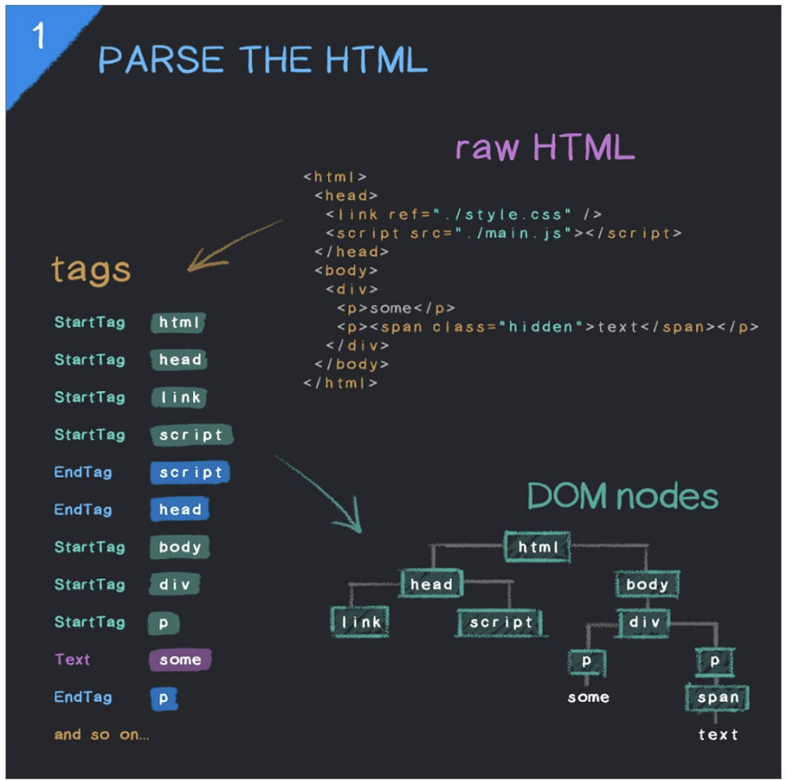

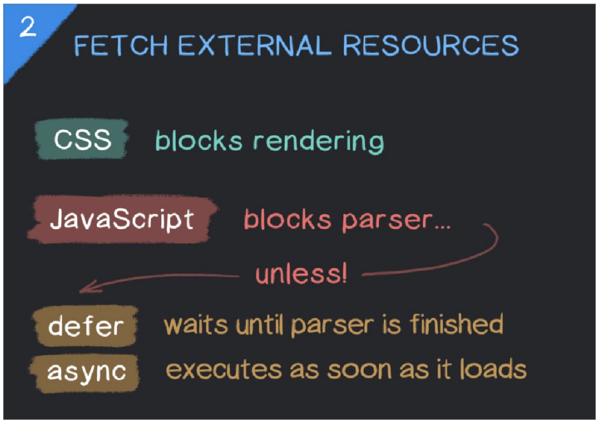

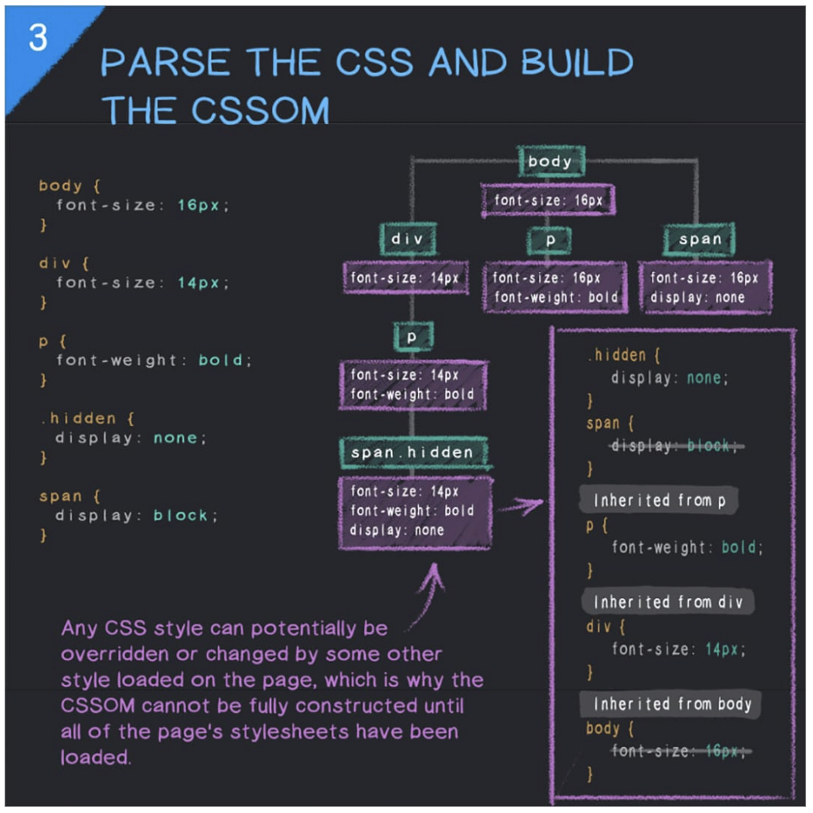

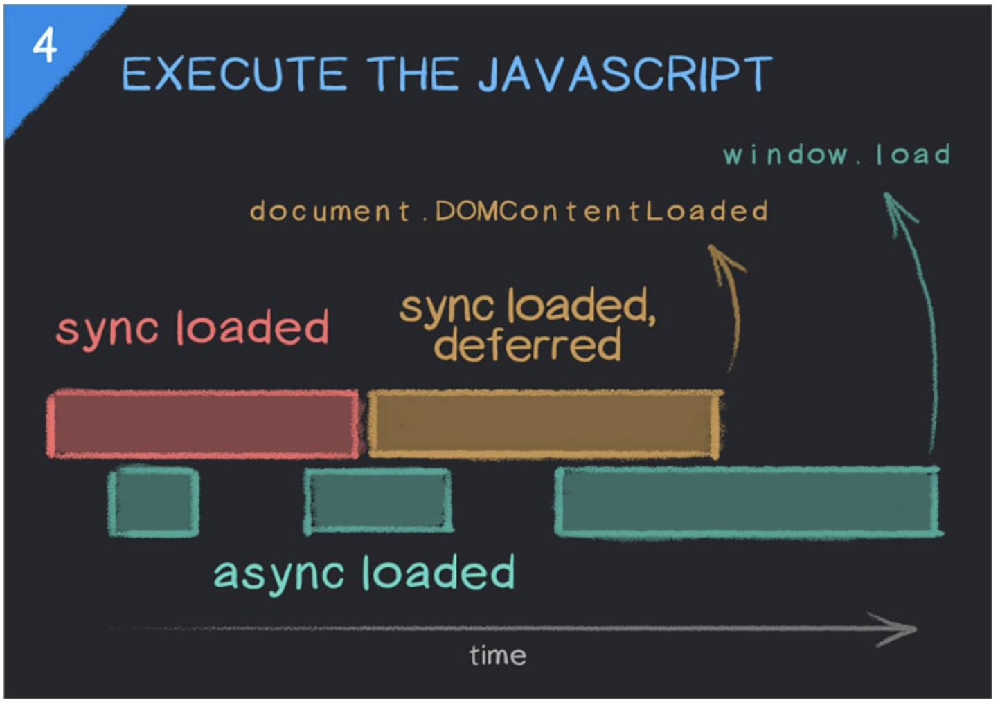

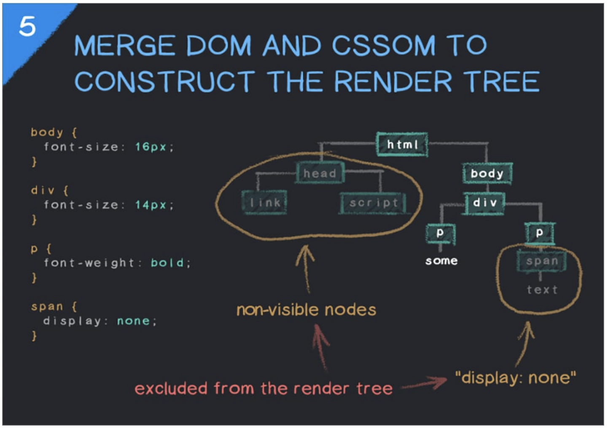

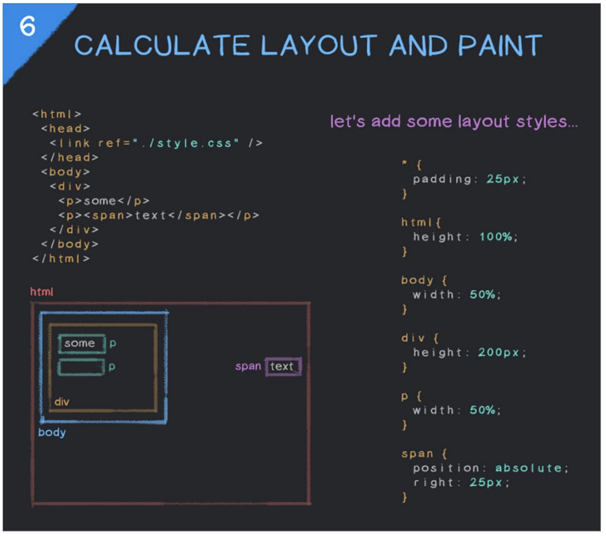

#### 1. Parse the HTML

The browser first downloads the HTML file and starts reading it from top to bottom. During this step, it breaks the HTML into tokens like start tags, end tags,
and text, and then uses those tokens to construct a tree structure called the DOM (Document Object Model). This DOM represents the structure of the page in memory, where each HTML element becomes a node and nested elements form
parent-child relationships.

#### 2. Fetch External Resources

While parsing the HTML, the browser encounters references to external resources such as CSS files `<link>`, JavaScript files `<script>` , images, or fonts. It sends
separate network requests to download these resources so they can be used later in rendering the page. This step ensures the browser has all the required assets
needed to style and run the page properly.

#### 3. Parse CSS and Build the CSSOM

Once CSS files are downloaded, the browser parses the CSS rules and converts them into another tree-like structure called the CSSOM (CSS Object Model). This structure represents all styling information for the page, including selectors, properties, and inheritance rules. The CSSOM allows the browser to quickly determine which styles apply to which DOM elements.

#### 4. Execute JavaScript

After loading JavaScript files, the browser executes them using the JavaScript engine. These scripts can interact with the DOM and CSSOM, modify elements,
add new nodes, or change styles dynamically. Because JavaScript can alter the page structure, the browser sometimes pauses HTML parsing while scripts run to
ensure the DOM stays consistent.

#### 5. Merge DOM and CSSOM to Form the Render Tree

Once both the DOM and CSSOM are ready, the browser combines them to create the Render Tree. This structure contains only the elements that need to be visually
displayed on the page, along with their computed styles. Elements like <head> or hidden elements may not appear here because they are not rendered visually.

#### 6. Layout and Paint

Finally, the browser calculates the exact position and size of every element in the render tree during the layout (reflow) phase. After layout is complete, the paint
step draws the pixels of each element on the screen, including text, colors, borders, and images. This process produces the final visual webpage that the
user sees.

#### Flow Summary

```js
HTML
↓
Parse HTML → DOM
↓
Fetch external resources (CSS, JS, images)
↓
Parse CSS → CSSOM
↓
Execute JavaScript
↓
DOM + CSSOM → Render Tree
↓
Layout (calculate positions)
↓
Paint (draw pixels on screen)
```
