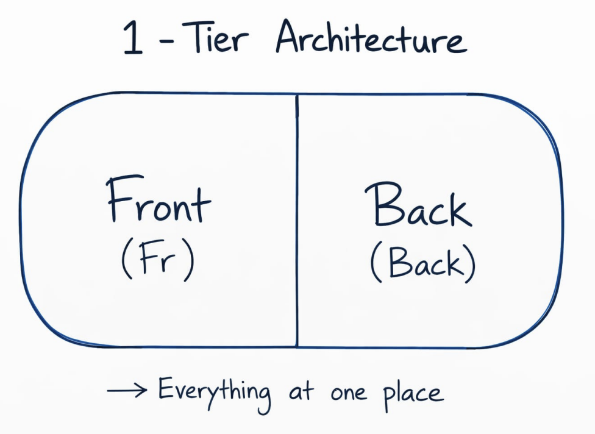
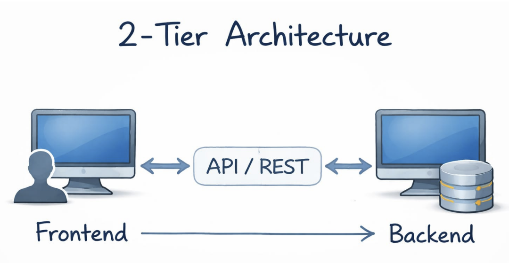
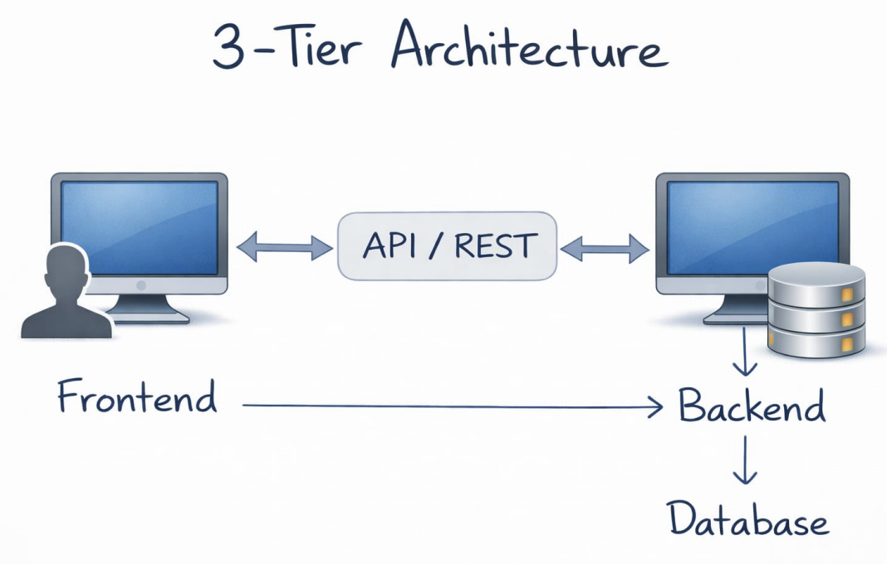
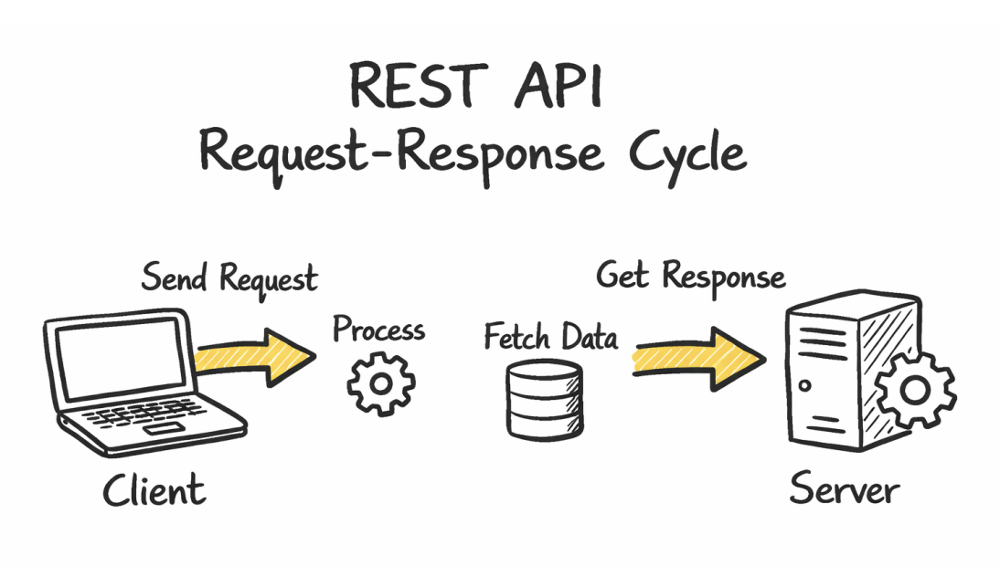
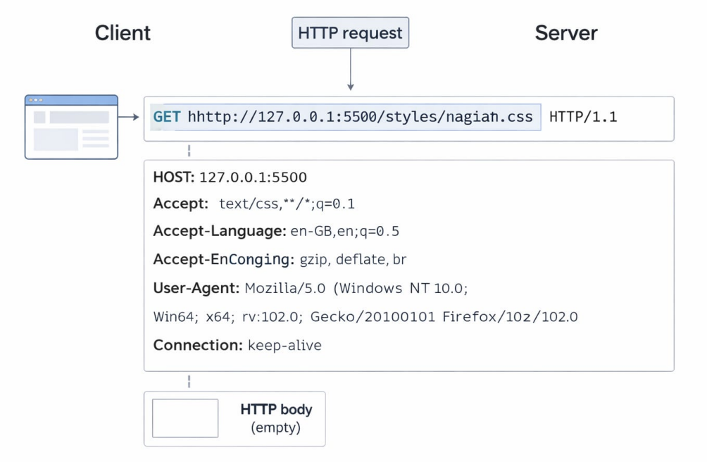
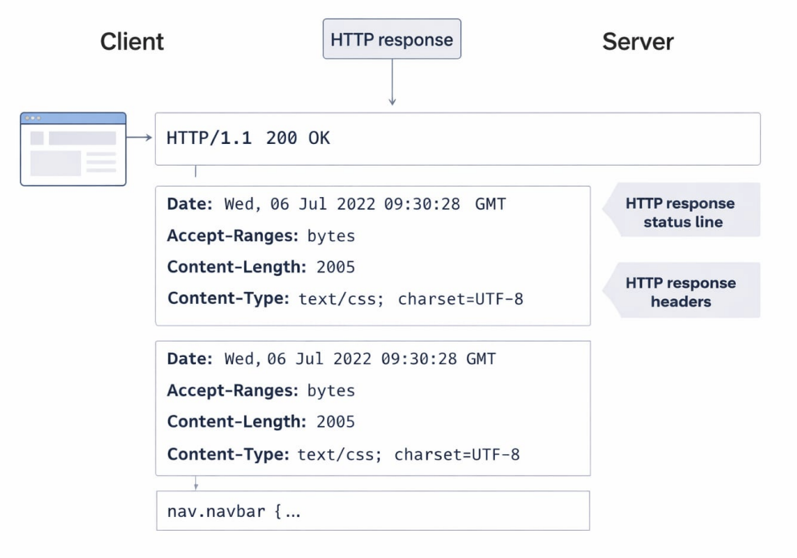
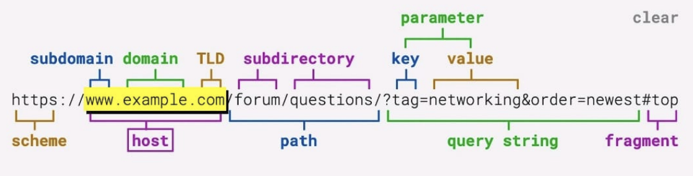

# REST APIs

## What is Rest Apis?

A REST API (Representational State Transfer Application Programming Interface) is an architectural style for networked applications that utilizes standard web protocols, primarily HTTP. It enables communication between clients and servers, allowing for the exchange of data and performance of actions in a standardized, stateless manner

Benefits of REST APIs

- Scalable – Stateless requests make it easier to scale applications.
- Platform Independent – Works with any client (web, mobile, desktop).
- Simple to Use – Uses standard HTTP methods like GET, POST, PUT, DELETE.
- Flexible Data Format – Usually uses JSON, which is lightweight and easy to parse.
- Separation of Concerns – Frontend and backend can be developed
  independently.
- Easy Integration – Can easily connect with third-party services and systems.

## Architecture

1 Tier

2 Tier

3 Tier

## Building Blocks

Request - Response

In the request–response cycle, a client sends an HTTP request to a server asking for data or an action to be performed.

The server processes the request and sends back an HTTP response, usually containing data (like JSON) or a status message.

### Request

#### HTTP Request

An HTTP request is sent by a client (browser) to a server to request a resource such as a webpage, CSS file, or API data.

It mainly contains three parts:

- Request Line – Includes the HTTP method, URL, and HTTP version (e.g., GET /styles.css HTTP/1.1 ).
- Request Headers – Provide metadata about the request like Host, UserAgent, Accept, Accept-Language, Connection, etc.
- Request Body – Optional data sent with the request (usually used in POST, PUT, PATCH requests). For GET requests, the body is typically empty.

### Response

#### HTTP Response

An HTTP response is sent by the server back to the client after processing an HTTP request.

It mainly contains three parts:

- Status Line – Includes the HTTP version, status code, and status message (e.g., HTTP/1.1 200 OK ), which indicates whether the request was successful or failed.
- Response Headers – Provide metadata about the response such as Date, Content-Type, Content-Length, Accept-Ranges, etc.
- Response Body – Contains the actual data returned by the server, such as HTML, CSS, JSON, or other resources (e.g., CSS code like nav.navbar { ... } ).

### URL

1. Scheme (Protocol) `https://`

- Defines the protocol used to communicate with the server.
- Common protocols: HTTP, HTTPS, FTP.

2. Subdomain `www`

- A subdivision of the main domain used to organize sections of a website.

3. Domain `example`

- The main name of the website that identifies it on the internet.

4. Top Level Domain (TLD) `.com`

- The last part of the domain name.
- Examples: .com , .org , .net , .edu .

5. Host `www.example.com`

- The complete domain name (subdomain + domain + TLD) that points to the server.

6. Path `/forum/questions`

- Specifies the exact resource or page on the server.

7. Query String `?tag=networking&order=newest`

- Contains parameters sent to the server to filter or modify the response.

8. Parameters (Key–Value pairs) `tag = networking` `order = newest`

- These are used by the server to process the request dynamically.

9. Fragment `#top`

- Points to a specific section inside the webpage.

> Note:
> The fragment ( #... ) is never sent to the server. It is handled entirely by the browser to navigate within the page, so the server has no knowledge of it.

### Features (CRUD)

- Create → Add something new
- View → Read existing
- Update → Update existing
- Delete → Remove something existing

### HTTP Methods

- POST → Create a new resource
- GET → Retrieve data
- PUT → Update an entire resource
- PATCH → Partially update a resource
- DELETE → Remove a resource

#### Other HTTP Methods

- HEAD → Same as GET but returns only headers (no body)
- OPTIONS → Shows allowed HTTP methods for a resource
- CONNECT → Establishes a network tunnel (used in proxies)
- TRACE → Returns the request for debugging purposes

## Headers

### Request Headers

| Header            | Use Case                                                                             | Example                                            |
| ----------------- | ------------------------------------------------------------------------------------ | -------------------------------------------------- |
| Host              | Specifies the target server/domain where the request is sent                         | `Host: www.example.com`                            |
| Origin            | Indicates the origin of the request (used in CORS validation)                        | `Origin: https://example.com`                      |
| Referer           | Shows the previous webpage from which the request was made                           | `Referer: https://example.com/previous-page`       |
| User-Agent        | Identifies the client making the request (browser, OS, device)                       | `User-Agent: Mozilla/5.0 Chrome/119`               |
| Accept            | Specifies the response content type the client expects                               | `Accept: application/json`                         |
| Accept-Language   | Indicates the preferred language for the response                                    | `Accept-Language: en-US,en;q=0.9`                  |
| Accept-Encoding   | Lists the compression formats supported by the client                                | `Accept-Encoding: gzip, deflate, br`               |
| Connection        | Controls whether the TCP connection stays open or closes                             | `Connection: keep-alive`                           |
| Authorization     | Sends authentication credentials (token, API key, etc.)                              | `Authorization: Bearer <token>`                    |
| Cookie            | Sends stored cookies from the browser to the server                                  | `Cookie: sessionId=abc123`                         |
| If-Modified-Since | Used for cache validation; server returns data only if modified after the given date | `If-Modified-Since: Wed, 21 Oct 2015 07:28:00 GMT` |
| Cache-Control     | Defines caching behavior for the request                                             | `Cache-Control: no-cache`                          |

### Response Headers

| Header                      | Use Case                                                                    | Example                                        |
| --------------------------- | --------------------------------------------------------------------------- | ---------------------------------------------- |
| Content-Type                | Specifies the format of the response body                                   | `Content-Type: application/json`               |
| Content-Length              | Indicates the size of the response body in bytes                            | `Content-Length: 348`                          |
| Date                        | The date and time when the response was generated                           | `Date: Tue, 15 Nov 2026 08:12:31 GMT`          |
| Server                      | Identifies the software used by the server                                  | `Server: nginx/1.24.0`                         |
| Set-Cookie                  | Sends cookies from the server to be stored by the client                    | `Set-Cookie: sessionId=abc123; HttpOnly`       |
| Cache-Control               | Defines caching rules for the response                                      | `Cache-Control: max-age=3600`                  |
| ETag                        | A unique identifier for a specific version of a resource (used for caching) | `ETag: "abc123xyz"`                            |
| Last-Modified               | Shows the last time the resource was modified                               | `Last-Modified: Wed, 21 Oct 2015 07:28:00 GMT` |
| Location                    | Redirects the client to another URL                                         | `Location: https://example.com/new-page`       |
| Access-Control-Allow-Origin | Defines which origins are allowed to access the resource (CORS)             | `Access-Control-Allow-Origin:*`                |
| Content-Encoding            | Indicates the compression used in the response                              | `Content-Encoding: gzip`                       |
| Connection                  | Controls whether the network connection stays open or closes                | `Connection: keep-alive`                       |

### HTTP Status Codes

#### 1xx — Informational

| Code | Meaning             | Description                                           |
| ---- | ------------------- | ----------------------------------------------------- |
| 100  | Continue            | Request received, client should continue sending body |
| 101  | Switching Protocols | Server switching protocols (e.g., HTTP → WebSocket)   |
| 102  | Processing          | Server has received request and is processing         |

#### 2xx — Success

| Code | Meaning    | Description                                  |
| ---- | ---------- | -------------------------------------------- |
| 200  | OK         | Request succeeded                            |
| 201  | Created    | Resource successfully created                |
| 202  | Accepted   | Request accepted but processing not complete |
| 204  | No Content | Success but no response body                 |

#### 3xx — Redirection

| Code | Meaning            | Description                                |
| ---- | ------------------ | ------------------------------------------ |
| 301  | Moved Permanently  | Resource permanently moved                 |
| 302  | Found              | Temporary redirect                         |
| 303  | See Other          | Redirect to another resource               |
| 304  | Not Modified       | Resource not modified (cache)              |
| 307  | Temporary Redirect | Same request method but temporary redirect |
| 308  | Permanent Redirect | Permanent redirect with same method        |

#### 4xx — Client Errors

| Code | Meaning                | Description                          |
| ---- | ---------------------- | ------------------------------------ |
| 400  | Bad Request            | Invalid request syntax               |
| 401  | Unauthorized           | Authentication required              |
| 403  | Forbidden              | Server refuses request               |
| 404  | Not Found              | Resource not found                   |
| 405  | Method Not Allowed     | HTTP method not supported            |
| 408  | Request Timeout        | Server timed out waiting             |
| 409  | Conflict               | Request conflicts with current state |
| 413  | Payload Too Large      | Request body too large               |
| 415  | Unsupported Media Type | Unsupported content type             |
| 429  | Too Many Requests      | Rate limit exceeded                  |

#### 5xx — Server Errors

| Code | Meaning               | Description                           |
| ---- | --------------------- | ------------------------------------- |
| 500  | Internal Server Error | Generic server failure                |
| 501  | Not Implemented       | Server doesn't support functionality  |
| 502  | Bad Gateway           | Invalid response from upstream server |
| 503  | Service Unavailable   | Server temporarily unavailable        |
| 504  | Gateway Timeout       | Upstream server timeout               |
