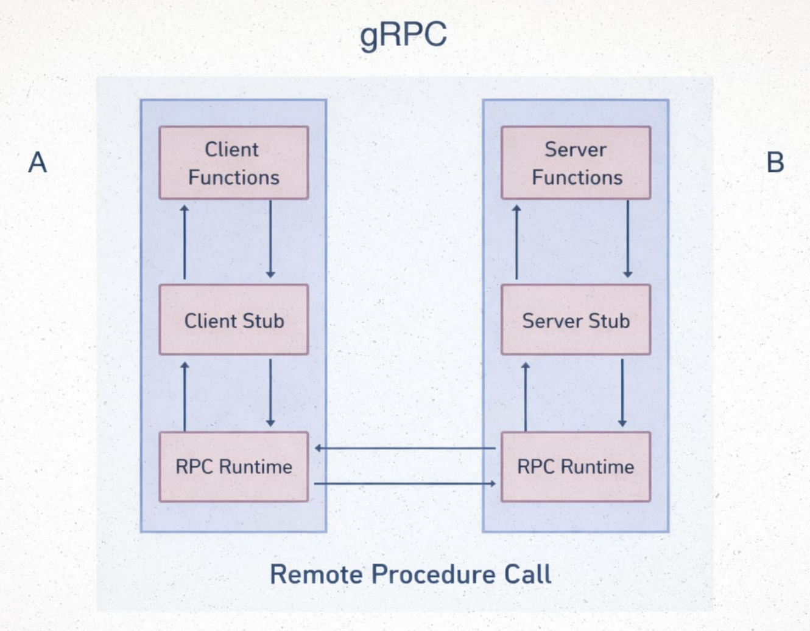
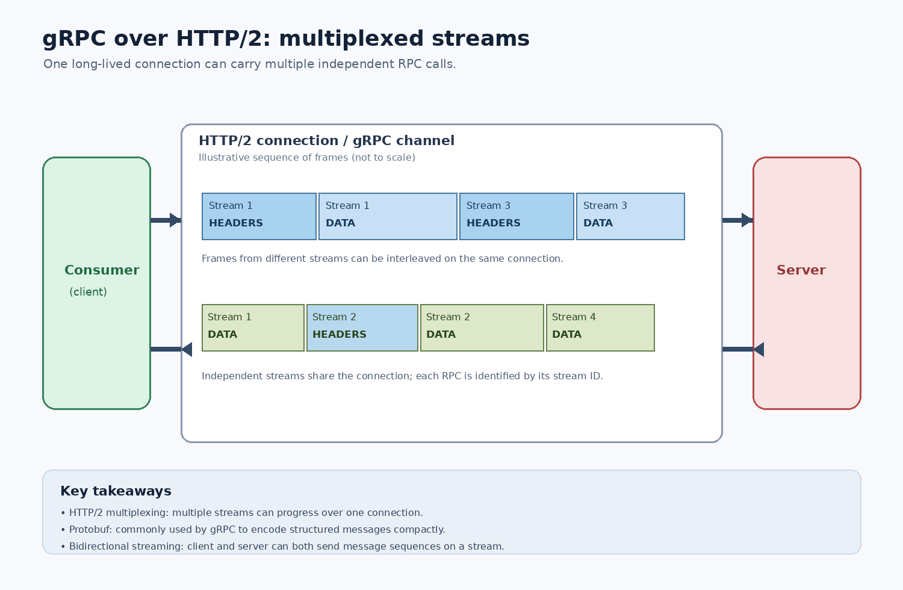
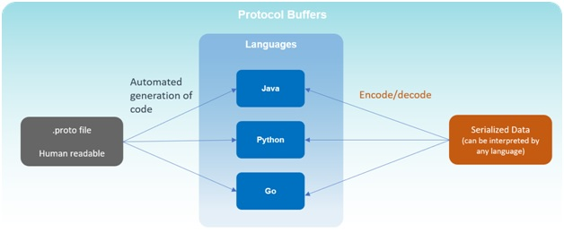
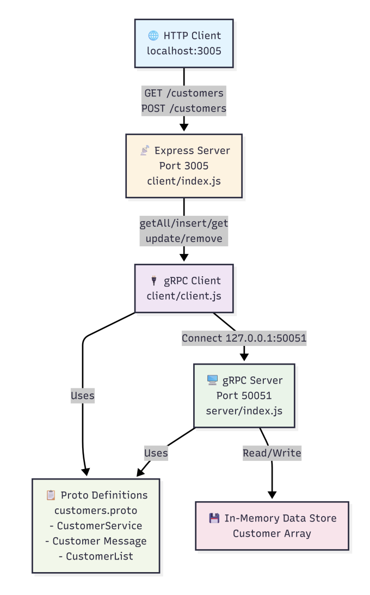

# gRPC



## What is gRPC

gRPC (Google Remote Procedure Call) is a framework that lets a client call functions on a remote server as if they were local functions.

## Why use gRPC

- Faster than REST (binary instead of JSON)
- Strongly typed (uses `.proto` contracts)
- Built for service-to-service communication

## How it works (based on your diagram)

### 1. Client Function

- You call a function like `getUser(id)`

### 2. Client Stub

- Acts like a proxy
- Converts function call → Protocol Buffer (binary format)

### 3. RPC Runtime

- Sends request over network using HTTP/2

### 4. Server Stub

- Converts binary data back to usable format
- Calls server function

### 5. Server Function

- Executes logic and returns response

### 6. Response path

- Server → Server Stub → RPC Runtime → Client Stub → Client

## Key concept

- Client Stub = like GraphQL resolver + API call layer
- RPC Runtime = network layer
- ProtoBuf = schema + data format



## Protocol Buffers (ProtoBuf)

Protocol Buffers is a data format + contract system used by gRPC. It defines how data is structured and transferred between client and server.

## Interface Definition Language (IDL)

ProtoBuf uses `.proto` files as an IDL.

Example:

```js
syntax = "proto3";
service UserService {
    rpc GetUser (UserRequest) returns (UserResponse);
}
message UserRequest {
    int32 id = 1;
}
message UserResponse {
    string name = 1;
}
```

What this does:

- Defines API methods ( rpc GetUser )
- Defines data structure ( UserRequest , UserResponse )
- Acts as a contract between client and server

## Serialization / Deserialization



### Serialization

- Convert structured data → binary format
- Happens at Client Stub

```js
{ id: 101 } → binary
```

### Deserialization

- Convert binary → structured data
- Happens at Server Stub

```js
binary → { id: 101 }
```

## Binary Support (Why it matters)

ProtoBuf uses binary encoding instead of JSON.

Benefits:

- Smaller size
- Faster transfer
- Less CPU usage
- Strong typing (no parsing ambiguity)

## Key Flow

```js
JS Object
→ Serialize (ProtoBuf)
→ Binary (over network)
→ Deserialize
→ Server Object
```

## Benefits of gRPC

- High performance
  - Uses binary (ProtoBuf) instead of JSON → smaller payloads, faster communication
- Strong typing
  - .proto contracts ensure strict request/response structure → fewer runtime errors
- Code generation
  - Automatically generates client + server code from .proto → less manual work
- HTTP/2 support
  - Multiplexing (multiple requests in one connection)
  - Header compression
  - Faster than HTTP/1.1
- Streaming support
  - Client streaming
  - Server streaming
  - Bidirectional streaming
- Cross-language support
  - Works across multiple languages (Node.js, Java, Go, Python, etc.)
- Better for microservices
  - Efficient internal communication between services

## REST vs gRPC

| Feature                             | REST                                          | gRPC                                                     |
| ----------------------------------- | --------------------------------------------- | -------------------------------------------------------- |
| Communication Protocol              | HTTP/1.1 or HTTP/HTTPS                        | HTTP/2 (default)                                         |
| Message Format                      | JSON / XML (text-based)                       | Protocol Buffers (binary)                                |
| IDL (Interface Definition Language) | No strict standard (OpenAPI / Swagger / WSDL) | `.proto` files (strict contract)                         |
| Data Serialization                  | Text-based (JSON, XML)                        | Binary (ProtoBuf)                                        |
| Efficiency                          | Slower (larger payloads,multiple requests)    | Faster (compact + multiplexing in HTTP/2)                |
| Flexibility                         | More flexible (loose schema)                  | Strict typing (strong contract)                          |
| RPC Styles                          | Request–Response (GET, POST, etc.)            | Unary, Client Streaming, Server Streaming, Bidirectional |
| Streaming                           | Limited (WebSockets / SSE workaround)         | Native streaming support                                 |
| Performance                         | Moderate                                      | High performance                                         |
| Use Case                            | Public APIs, web apps                         | Microservices, real-time systems                         |
| Learning Curve                      | Easy                                          | Slightly steep                                           |

## gRPC: Advantages vs Disadvantages

| Advantages                                | Disadvantages                         |
| ----------------------------------------- | ------------------------------------- |
| High performance (binary + HTTP/2)        | Not browser-friendly (needs gRPC-Web) |
| Smaller payload size (ProtoBuf)           | Harder to debug (binary data)         |
| Strong typing with .proto contracts       | Learning curve (IDL + tooling)        |
| Supports streaming (bi-directional)       | Limited human readability             |
| Efficient for microservices communication | Less flexible than REST               |
| Built-in code generation                  | Requires schema management            |

## Code and Architecture


